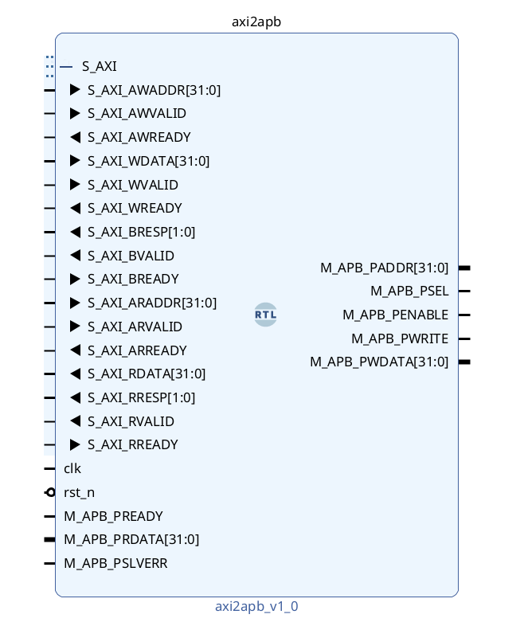
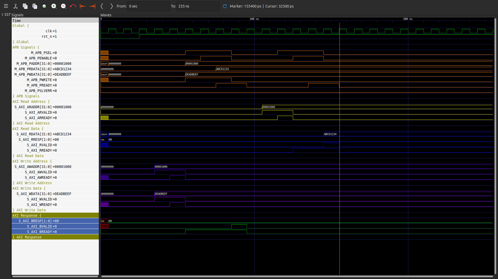

# AXI to APB Bridge (AXI2APB)

## Overview

This project implements a synthesizable **AXI4-Lite to APB3 protocol bridge** with full support for address, data, and response channels. Designed for interoperability between high-performance AXI masters and low-power APB slaves, the bridge ensures protocol compliance, reliable data transfer, and accurate handshake timing.

---

## Features

- **Protocol Conversion**: Converts AXI4-Lite transactions into APB3-compliant operations.
- **Parameterizable Design**: Customizable address/data widths.
- **FSM-based Control**: Deterministic state machine to sequence AXI/ APB transactions.
- **Protocol Compliance**: Adheres strictly to APB timing and AXI response generation.
- **Error Propagation**: APB error handling reflected on AXI BRESP/RRESP.

---

## Highlights

- **RTL Module:** `axi2apb.v`
- **Testbench:** Validates functionality using AXI stimulus
- **Simulation:** Performed using **Icarus Verilog** and analyzed via **GTKWave**
- **Synthesis & Timing:** Done with **Yosys** and **OpenSTA**
- **PDK:** SkyWater `sky130_fd_sc_hd` standard cell library

---

## Tools Used

- **Yosys** – RTL synthesis  
- **OpenSTA** – Static Timing Analysis  
- **Icarus Verilog** – Simulation
- **GTKWave** – Waveform visualization  
- **SkyWater 130nm PDK** – Cell library

---

## Simulation Waveform

Simulation waveform showing AXI transactions being translated and executed as APB3 operations, demonstrating protocol adherence and correct handshake timing.
